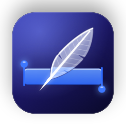

<p align="center"></p>

<h1 align="center">Quill</h1>

<p align="center">Leave every Teams meeting with the minutes done — transcribed, every voice by name,<br>translated live, on your Mac. And rewrite any text in the voice its reader expects. Free and open source.</p>

<p align="center"><a href="https://quill.rrios.dev/download"><b>Download for macOS</b></a> · <a href="https://quill.rrios.dev/en">quill.rrios.dev</a></p>

<p align="center"></p>

---

When Teams opens the microphone, Quill asks whether to transcribe the call. It transcribes
it on your Mac, tells the voices apart so you can name them as you talk, translates it live
if it is in another language and, when you hang up, gives you the minutes: decisions, tasks
with owner and date, risks and disagreements. No bot joins the call and no audio is kept.

And when you have to write: select text anywhere — a Teams message, an e-mail, a note —
press **⌃⌥R**, and Quill rewrites it for whoever will read it.

## Meetings

It works with Microsoft Teams, Zoom, Webex, Slack, FaceTime, GoTo Meeting, Gather,
Discord, WhatsApp, Telegram and Signal, and with any meeting in a browser (Google Meet,
Teams or Zoom on the web…) in Chrome, Safari, Edge, Arc, Dia, Brave, Firefox, Zen, Opera,
Vivaldi, Chromium or Comet. For any other app, *Transcribe a meeting* in the menu offers
whichever app has the microphone open. So far it has been tried in real calls only in
Teams. Quill listens to the meeting app's audio and to your microphone
separately, so "you" and "the others" are never confused.

- **Transcribed on your Mac** with the system's speech model, in the language you pick
  when the meeting starts (Spanish, English, French, German, Italian, Portuguese).
- **Every voice by name.** Voices are told apart on your Mac while the meeting goes on:
  name each one and give it a role (Product Owner, Tech Lead, Support…) as people speak,
  and the names stay.
- **Translated live** with Apple's on-device translation when the meeting is in another
  language than yours.
- **A live panel** you can move, resize or fold into a recording dot.
- **When it ends**, one window with the people, the transcript and the analysis, for the
  focus you choose:

  | Focus | What you get |
  |---|---|
  | **Product minutes** | Decisions, tasks with owner and date as they were said, risks and disagreements. |
  | **Analysis** | Each topic with the options on the table, who argued for each and why, and what was decided. |
  | **Brief** | Five lines for whoever wasn't there. |
  | **Your own** | Write what you want from a meeting; Quill keeps it as a focus. |

- **Weighted by role.** In product minutes what the Product Owner says is a decision and
  what support says is context; each focus says how much each role counts, and Quill
  remembers each person's role for the next meeting.
- **No audio is ever saved** — only the text. Meetings are kept for the days you decide.
  The analysis is written by the model you choose, in your language.

Quality is measured, not assumed: a bench of meetings with real voices and a known answer
([`TESTING-MEETINGS.md`](docs/initiatives/quill/TESTING-MEETINGS.md)) — on a ten-minute
Spanish meeting, 3–4 % word error rate and five of five voices told apart.

## Rewriting

Select text where you write and press **⌃⌥R**. Quill shows the rewrite next to the
selection; press Return and it replaces the text where you were typing. Or type what you
want ("shorter", "in English", "warmer") and press Return.

How it rewrites depends on who will read it. Quill does it with **profiles**: a way of
rewriting for each kind of reader, which you can tune, test and give examples to.

| Profile | What it does |
|---|---|
| **Spelling only** | Fixes spelling, accents and punctuation. Leaves every word you chose. |
| **Work** | Clear and cordial: splits run-on sentences, drops filler, keeps technical terms. |
| **Formal** | Formal register for clients, landlords and lawyers, without inventing obligations. |
| **Friends** | Fixes typos and keeps the slang, the laughter and the emoji. |
| **Clean up dictation** | Removes the ums, repetitions and false starts of dictated text. |
| **Concise** | Cuts padding and keeps every fact and request. |

Make your own, pin a model to a profile, or give an app its default ("in Teams, use Work";
optionally applied without the picker).

## Models

Quill does not ship a model and has no server. You choose who writes the minutes and the rewrites:

- **Apple Intelligence**, on your Mac: free and private, for short texts.
- **OpenRouter**, **Vercel AI Gateway** or **OpenAI**, with your own API key.
- **Any OpenAI-compatible server**, such as Ollama or LM Studio on your network.

Each model is labelled by how well it does each profile — *works well*, *may need review*
or *not recommended* — measured on a bench of real cases, not guessed. Today Google's
Gemini 3.8 Flash (through OpenRouter or Vercel) works well on every built-in profile.

## Nothing it should not do

Every result goes through output guards before you can apply it. They check that names,
numbers, links and emoji survive; flag anything the text did not say — a figure, a date, a
greeting, a closing note, a placeholder; and catch a model that refuses or copies an
example. A flagged result tells you why, and it is never applied without you seeing it.

## Privacy

- Your text goes **only** to the provider you chose, and only when you ask for a rewrite
  or a meeting analysis. Hosted providers are asked once before the first use.
- Meetings: audio stays in memory and is never written to disk. Transcription, voice
  separation and translation run on your Mac; only the analysis goes to your model.
- API keys live in the macOS Keychain.
- No account, no analytics, no telemetry, no server of our own. Release builds log no text.
- Password fields are never read.

## Requirements

macOS 26 or later on Apple silicon. Quill needs the **Accessibility** permission to read
the selection and replace it; the first run walks you through it. Apple Intelligence is
optional.

Meetings also ask for **System Audio Recording** (to hear the meeting app) and the
**Microphone**. The first meeting in a language downloads the system's speech model for it;
the first separation of voices downloads the diarization models (about 20 MB) of
[FluidAudio](https://github.com/FluidInference/FluidAudio) (Apache 2.0), the one
third-party library Quill uses, since macOS has no voice separation of its own.

## Building from source

The layout mirrors the monorepo Quill is exported from: the app is in `native/quill`, and
two libraries it shares with [Ámbar](https://github.com/rrios-dev/ambar) are in
`native/packages`.

Build releases with **Xcode 27**: an older Xcode builds Quill too, but without the macOS 27
SDK it maps the on-device model's newer errors generically. The app runs on macOS 26 and
later.

```bash
cd native/quill
swift build
swift test
Scripts/make-app.sh debug      # build/debug/Quill.app, signed with your Developer ID
```

`Scripts/make-app.sh` signs with a Developer ID Application identity from your keychain;
macOS ties the Accessibility grant to the signature, so an ad-hoc signed build loses it on
every rebuild. `Scripts/verify.sh` is the maintainer's release gate and also checks the rest
of the monorepo; outside it, `swift test` and `Scripts/check-localization.sh` are what CI
runs.

The design documents are in [`docs/initiatives/quill`](docs/initiatives/quill):
[product](docs/initiatives/quill/PRODUCT.md),
[architecture](docs/initiatives/quill/ARCHITECTURE.md),
[providers](docs/initiatives/quill/PROVIDERS.md),
[the bench](docs/initiatives/quill/BENCH.md) that measures each model and profile
(`quill-bench`, in `native/quill/tools/QuillBench`),
[meetings](docs/initiatives/quill/MEETINGS.md) and
[how meetings are tested](docs/initiatives/quill/TESTING-MEETINGS.md) (`meeting-bench`, in
`native/quill/tools/MeetingBench`).

## License

[MIT](LICENSE). Made by [Roberto Ríos](https://rrios.dev).
